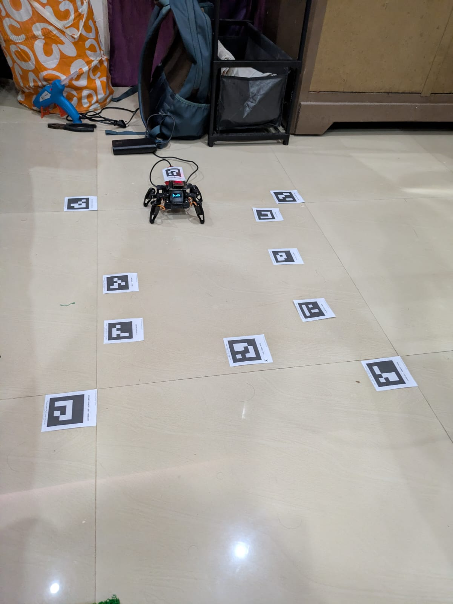
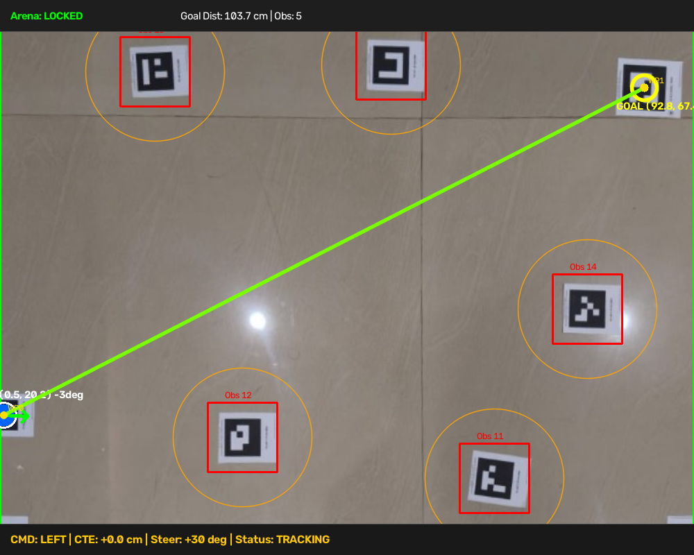
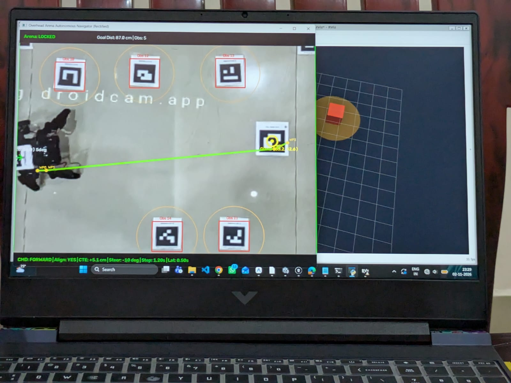
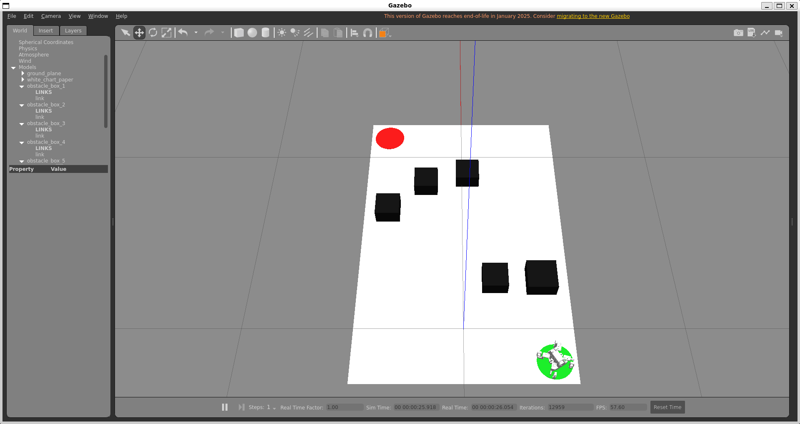
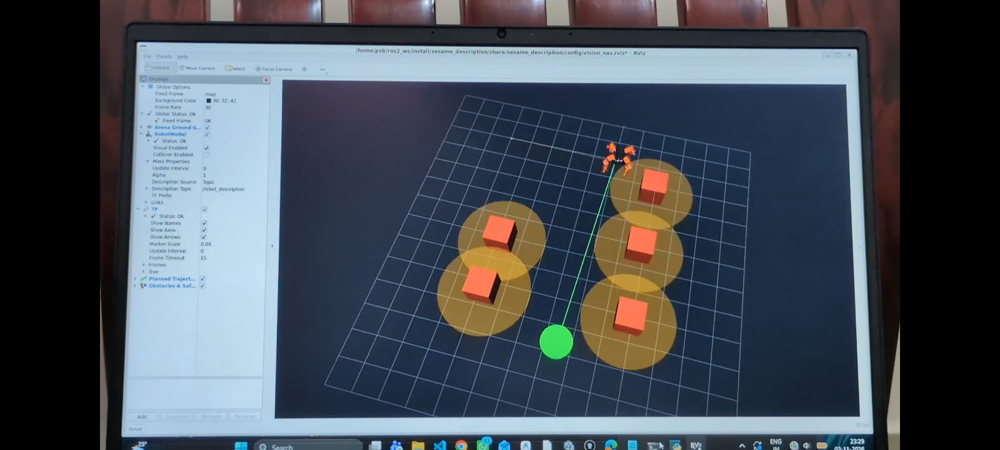
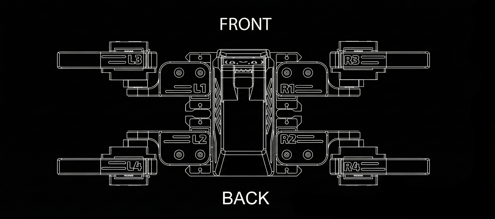
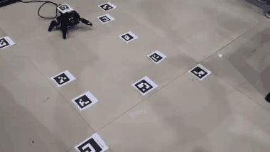
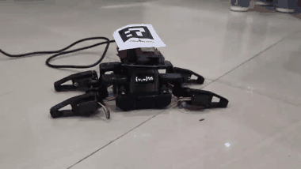

# SesameNav: Vision-Guided Autonomous Quadruped Navigator & 3D Digital Twin

<div align="center">

[](https://docs.ros.org/en/humble/)
[](https://gazebosim.org/)
[](https://opencv.org/)
[](https://www.python.org/)
[](https://www.espressif.com/)
[](https://github.com/PrithviBhende/sesame-nav)

**An end-to-end autonomous robotics system featuring real-time overhead computer vision tracking (ArUco planar homography), dynamic A\* path planning with strict $\ge 5\text{ cm}$ obstacle clearance, Stanley steering path-following control, human hand safety gating, ESP32 Wi-Fi hardware-in-the-loop actuation, and a live ROS 2 Humble RViz / Gazebo 3D Digital Twin.**

[Evidence Gallery](#-project-gallery--visual-evidence) •
[System Architecture](#-system-architecture--data-flow) •
[Gait Kinematics](#-how-the-robot-walks-locomotion--gait-mechanics) •
[Servo Calibration](#-hardware-servo-calibration--real-life-angles) •
[Experiments](#-key-experiments--engineering-lessons-learned) •
[Getting Started](#-getting-started--operating-modes) •
[Honorable Mentions](#-honorable-mentions--attributions)

</div>

---

> 📖 **In-Depth Engineering Reference**: For detailed mathematical proofs, pixel-to-metric homography derivations, CPG wave equations, and network protocol breakdowns, read the comprehensive guide: [`docs/PROJECT_DOCUMENTATION.md`](docs/PROJECT_DOCUMENTATION.md).

---

## 📸 Project Gallery & Visual Evidence

Here are the real-world test results, simulations, and telemetry captures from the physical setup:

### Real-World Arena & Live Navigation

| Real-World Physical Arena Setup | Top-Down Rectified Navigation HUD |
| :---: | :---: |
|  |  |
| *Physical 8-DOF Sesame quadruped on tiled arena with ArUco boundary corners (0–3), goal target (5), and overhead camera.* | *OpenCV planar homography view (10 px/cm) displaying real-time A\* path (green), robot pose, waypoints, and CTE steering bar.* |

---

### ROS 2 Humble RViz & Gazebo 3D Digital Twin

| RViz Live Camera Path Navigation | Gazebo 3D Arena Simulation |
| :---: | :---: |
|  |  |
| *RViz Digital Twin receiving live telemetry via UDP: 3D robot model, planned `/path` (green line), and detected obstacle cubes.* | *Gazebo Classic simulation world (`chartpaper_arena.world`) with contact physics, joint controllers, and drag-and-drop obstacle blocks.* |

| RViz 3D Digital Twin Pose & TF Frame Tree | Top-Down CAD Kinematic Layout |
| :---: | :---: |
|  |  |
| *Full kinematic tree showing `/base_link`, `/hip`, and `/knee` transforms synchronized with physical robot walking pulses.* | *Top-down anatomical joint map showing servo arrangement, limb naming (`L1`–`L4`, `R1`–`R4`), and positive rotation vectors.* |

---

### 🎥 Physical Robot Video Demonstrations

| 1. Autonomous Forward Walking & Gait Execution | 2. Robot Greeting & Wave Sequence |
| :---: | :---: |
| <br/>[▶️ **Watch / Download Full MP4 Video (`docs/evidence/bot_walking.mp4`)**](docs/evidence/bot_walking.mp4) | <br/>[▶️ **Watch / Download Full MP4 Video (`docs/evidence/bot_saying_hi_and_dancing.mp4`)**](docs/evidence/bot_saying_hi_and_dancing.mp4) |
| *Physical 8-DOF Sesame executing calibrated 6-phase diagonal trot locomotion across tiled floor.* | *Calibrated high-stepping balance and greeting wave sequence.* |

---

## 🏛 System Architecture & Data Flow

```
                      Overhead Video Ingestion
               (USB DroidCam / IP Stream / Webcam)
                                 │
                                 ▼
               ┌───────────────────────────────────┐
               │         vision_tracker.py         │
               │  • Multi-version ArUco Detector   │
               │  • 4-Corner Planar Homography     │
               │  • Metric Space Transform (10px/cm)│
               │  • EMA Pose Smoothing (α = 0.65) │
               │  • Real-Time Hand Mask (HSV)      │
               └─────────────────┬─────────────────┘
                                 │ Telemetry Dict (Robot cm, Goal cm, Obs cm)
                                 ▼
               ┌───────────────────────────────────┐
               │         vision_planner.py         │
               │  • Dynamic 2D Grid Representation │
               │  • >= 5.0 cm Clearance Inflation  │
               │  • Dynamic A* Shortest Path Search│
               │  • Line-of-Sight String Pulling   │
               └─────────────────┬─────────────────┘
                                 │ Planned Metric Path [(x0, y0), (x1, y1), ...]
                                 ▼
               ┌───────────────────────────────────┐
               │       stanley_controller.py       │
               │  • Cross-Track Error (CTE) Law    │
               │  • Heading Error Alignment        │
               │  • ±10° Heading Deadband Filter   │
               │  • 1.2s Natural Stride Pacing     │
               └─────────┬───────────────────┬─────┘
                         │                   │
      Wi-Fi HTTP GET     │                   │  UDP JSON & IPC (/path, /tf)
      `/cmd?go=forward`  │                   │  Port 9090 Broadcast
                         ▼                   ▼
       ┌────────────────────────┐  ┌────────────────────────┐
       │ Physical Sesame ESP32  │  │  ROS 2 Humble / RViz   │
       │  • 8x TowerPro Servos  │  │  • 3D Robot State      │
       │  • SoftAP Controller   │  │  • Real-Time TF Tree   │
       │  • Calibrated Gaits    │  │  • Green Waypoint Path │
       │  • Auto-Stop on Hand   │  │  • Dynamic 3D Obstacles│
       └────────────────────────┘  └────────────────────────┘
```

---

## 🐾 How the Robot Walks: Locomotion & Gait Mechanics

### 1. Kinematic Structure (8 Degrees of Freedom)
The Sesame quadruped is actuated by **8 independent micro-servos** (TowerPro MG90S metal-gear or SG90):
* **4 Hip Servos (`R1`, `R2`, `L1`, `L2`)**: Control horizontal abduction/adduction and forward/backward leg sweep.
* **4 Knee Servos (`R3`, `R4`, `L3`, `L4`)**: Control vertical femur-tibia flexion and extension to lift or plant the feet.

```
       Front of Robot
    [L1 Hip]      [R1 Hip]
    [L3 Knee]     [R3 Knee]
        │             │
        ├─────────────┤   Chassis / ESP32
        │             │
    [L2 Hip]      [R2 Hip]
    [L4 Knee]     [R4 Knee]
        Rear of Robot
```

### 2. Walking Gait Sequence (6-Phase Diagonal Trot)
Quadruped stability requires keeping the center of mass (CoM) inside the polygon of support formed by the planted feet:
1. **Phase 1 (Right Diagonal Swing)**: Front-Right knee (`R3`) and Rear-Left knee (`L4`) lift upward off the ground.
2. **Phase 2 (Forward Step)**: Front-Right hip (`R1`) and Rear-Left hip (`L2`) swing forward into the walking direction.
3. **Phase 3 (Right Diagonal Plant)**: `R3` and `L4` extend down to firmly touch the floor, forming a stable stance.
4. **Phase 4 (Left Diagonal Swing)**: Front-Left knee (`L3`) and Rear-Right knee (`R4`) lift off the ground.
5. **Phase 5 (Forward Step)**: Front-Left hip (`L1`) and Rear-Right hip (`R2`) swing forward while the grounded legs propel the body forward.
6. **Phase 6 (Left Diagonal Plant)**: `L3` and `R4` plant down, completing a full stride.

### 3. Why the 1.2-Second Step Cadence is Critical
In our early experiments, sending commands rapidly (every 100–200 ms) caused the robot to **"crab walk"** (drift diagonally or sideways) or fail to take a step because:
* A physical 6-phase stride cycle takes **$\approx 1.25\text{ seconds}$** to mechanically complete.
* If a new steering or movement command arrives mid-step, the ESP32 interrupts the unfinished phase, leaving one leg in mid-air while the next leg fires. This breaks symmetry and causes crab-like lateral drift.
* By pacing the navigator loop with `--interval 1.2`, the Python controller commands one full, natural step pulse, pauses for 1.2s while the mechanical step finishes, and then re-evaluates the visual position and heading error.

---

## ⚙️ Hardware Servo Calibration & Real-Life Angles

### Why Default Firmware Angles Failed
When assembling 3D-printed quadruped kits, servos cannot simply be commanded to $90^\circ$ because:
1. **Mechanical Spline Tolerances**: The teeth on servo output shafts have discrete tooth spacing ($15^\circ\text{--}20^\circ$ per spline). Screwing on a horn at "approximate $90^\circ$" leaves a random angular offset of $\pm 5^\circ\text{--}10^\circ$.
2. **Opposite-Flank Inversion**: 
   * On the **Right flank**, increasing knee PWM angle extends the leg downward ($87^\circ \to 151^\circ$).
   * On the **Left flank**, the servo is mounted in reverse (mirror orientation). To extend the left leg downward, you must **decrease** the PWM angle ($79^\circ \to 19^\circ$)!
   * Symmetrical firmware that sends identical degree numbers to both sides causes the right leg to stand while the left leg curls up into the torso, instantly flipping the robot over.

### Calibrated Servo Angle Reference Table

| Joint | Anatomical Location | ESP32 GPIO Pin | Sitting (Horn Mounted) | Standing (Calibrated) | Motion Range Limits | Action Direction |
| :---: | :--- | :---: | :---: | :---: | :---: | :--- |
| **`R1`** | Front-Right Hip | **15** | $78^\circ$ | **$104^\circ$** | $75^\circ \text{ to } 174^\circ$ | Increasing angle points forward |
| **`R3`** | Front-Right Knee | **16** | $87^\circ$ | **$151^\circ$** | $0^\circ \text{ to } 180^\circ$ | Increasing angle extends leg down |
| **`R2`** | Rear-Right Hip | **2** | $82^\circ$ | **$52^\circ$** | $21^\circ \text{ to } 90^\circ$ | Decreasing angle points forward |
| **`R4`** | Rear-Right Knee | **4** | $91^\circ$ | **$32^\circ$** | $0^\circ \text{ to } 180^\circ$ | Decreasing angle extends leg down |
| **`L1`** | Front-Left Hip | **23** | $98^\circ$ | **$72^\circ$** | $5^\circ \text{ to } 100^\circ$ | Decreasing angle points forward |
| **`L3`** | Front-Left Knee | **17** | $79^\circ$ | **$19^\circ$** | $0^\circ \text{ to } 180^\circ$ | Decreasing angle extends leg down |
| **`L2`** | Rear-Left Hip | **19** | $81^\circ$ | **$101^\circ$** | $76^\circ \text{ to } 168^\circ$ | Increasing angle points forward |
| **`L4`** | Rear-Left Knee | **18** | $83^\circ$ | **$148^\circ$** | $0^\circ \text{ to } 180^\circ$ | Increasing angle extends leg down |

---

### Step-by-Step Angle Calibration Procedure

All necessary sketches are organized in the `firmware/` directory:

```text
firmware/
├── servo_90/                     # Initial assembly centering sketch
│   └── servo_90.ino
├── quadruped_calibration/        # Interactive Wi-Fi slider calibration portal
│   ├── quadruped_calibration.ino
│   ├── calibration-portal.h
│   └── quadruped_calibration.csv
├── quadruped_mini/               # Production autonomous walking firmware
│   ├── quadruped_mini.ino
│   ├── movement-sequences.h
│   └── captive-portal.h
└── sesame_motor_tester/          # Individual servo test utility
    └── sesame_motor_tester.ino
```

#### Step 1: Center All Servos to $90^\circ$ (Mechanical Assembly)
1. Open [`firmware/servo_90/servo_90.ino`](firmware/servo_90/servo_90.ino) in Arduino IDE.
2. Select board **ESP32 Dev Module** and flash via USB.
3. The sketch powers each servo to exactly $90^\circ$ with a 100ms staggered delay to avoid current spikes.
4. With servos powered at $90^\circ$, press the 3D-printed horns onto the splines as close to perpendicular as possible and tighten the center screws.

#### Step 2: Interactive Trim via Wi-Fi Web Dashboard
1. Open and flash [`firmware/quadruped_calibration/quadruped_calibration.ino`](firmware/quadruped_calibration/quadruped_calibration.ino).
2. The ESP32 boots a Wi-Fi Access Point:
   * **SSID:** `Quadruped-Calibration`
   * **Password:** `password123`
3. Connect your laptop or phone to this Wi-Fi network and navigate to `http://192.168.4.1`.
4. Use the 8 interactive joint sliders to trim each leg:
   * Adjust knee heights so all 4 feet touch the ground simultaneously with the chassis level.
   * Adjust hip angles so the legs are symmetrically splayed.
5. Record your trimmed angles or download the exported `quadruped_calibration.csv`.

#### Step 3: Flash the Production Walking Firmware
1. Open [`firmware/quadruped_mini/quadruped_mini.ino`](firmware/quadruped_mini/quadruped_mini.ino).
2. Verify that `movement-sequences.h` uses your calibrated standing and walking values.
3. Flash the robot. The robot will now boot in `Quadruped-Controller` mode (password: `12345678`) ready for autonomous commands over Wi-Fi.

---

## 🔬 Key Experiments & Engineering Lessons Learned

Throughout development and physical testing, we conducted several systematic experiments:

### 1. Camera Video Ingestion: Wi-Fi vs Wired USB Latency
* **Hypothesis**: Streaming overhead video from a phone via Wi-Fi RTSP/HTTP (DroidCam / IP Webcam) would provide wireless convenience.
* **Finding**: Wi-Fi video streaming introduced variable network lag of **$300\text{--}600\text{ ms}$**, along with frame compression artifacts. Because the overhead vision was delayed, the Stanley controller calculated steering based on where the robot was half a second ago, causing steering oscillation.
* **Solution**: Switching to **Wired USB mode** (using Android USB debugging / DirectShow backend index `0` or `1`) slashed video transport latency to **$< 50\text{ ms}$**. The robot reacted instantly to path changes.

### 2. Elimination of "Crab-Walking" via Cadence Sync
* **Hypothesis**: High-frequency commands ($10\text{ Hz}$) from the computer would provide tighter closed-loop tracking.
* **Finding**: The ESP32 firmware executes a non-preemptible 6-step gait loop. Flooding it with frequent HTTP requests clogged the network buffer and forced phase cutoffs, resulting in a crab-like diagonal drift.
* **Solution**: Implemented discrete step pacing (`--interval 1.2`). The navigator issues one movement pulse, waits for the physical stride to plant both feet, and only then takes a fresh vision frame to measure cross-track error.

### 3. Steering Deadband ($\pm 10^\circ$)
* **Hypothesis**: Correcting every fraction of a degree of heading error would keep the robot perfectly collinear with the path.
* **Finding**: Sub-pixel camera jitter and slight chassis vibrations caused the heading calculation to flutter by $\pm 2^\circ\text{--}4^\circ$, making the robot continuously alternate between Left and Right turn pulses instead of walking forward.
* **Solution**: Added a $\pm 10^\circ$ deadband in `stanley_controller.py`. If the heading error $|\theta_e| \le 10^\circ$, the controller treats the robot as aligned and commands pure forward locomotion.

### 4. Swapped ArUco Marker Mitigation (`--swap-ids`)
* **Finding**: In physical testing, marker ID 5 was accidentally attached to the robot top plate and ID 4 was placed on the floor as the destination. The computer attempted to command the floor paper to steer toward the robot!
* **Solution**: Added `--swap-ids` and `--robot-id` / `--goal-id` CLI flags in `main_vision_navigator.py`. Users can dynamically flip tracking targets in software without peeling off physical stickers.

### 5. Dynamic Obstacle Avoidance & Hand Safety Interlock
* **Finding**: Testing showed that robots often brushed the corners of obstacle boxes if planned paths only touched the outer edge.
* **Solution**: Inflated obstacle bounding boxes with a strict **$5.0\text{ cm}$ safety clearance radius**.
* **Hand Detection**: Added an HSV skin-color thresholding detector. When a human hand enters the arena to rearrange boxes, the robot immediately enters safe stand mode (`stop=1`), holding replanning until the hand has cleared the scene for $> 0.4\text{ s}$.

---

## 🚀 Getting Started & Operating Modes

### Prerequisites

```powershell
# Clone the repository
git clone https://github.com/PrithviBhende/sesame-nav.git
cd sesame-nav

# Install Python requirements
pip install opencv-python numpy
```

---

### Camera Setup & Recommended Apps

You can use any overhead camera: a standard USB webcam, a phone running DroidCam, or an IP camera.

1. **DroidCam (Recommended for Ultra-Low Latency USB & Wi-Fi)**:
   * **PC Client & App**: [https://www.dev47apps.com/](https://www.dev47apps.com/)
   * Supports both wired USB mode (Android USB debugging, zero latency) and Wi-Fi mode.
2. **IP Webcam (Android Alternative)**:
   * **Google Play**: [IP Webcam on Play Store](https://play.google.com/store/apps/details?id=com.pas.webcam)
   * Streams MJPEG feed over Wi-Fi (`http://<phone-ip>:8080/video`).
3. **Hardware USB Webcams**:
   * Any UVC plug-and-play USB webcam mounted overhead on a tripod or boom arm.

#### Diagnostic Camera Scanner
Before launching navigation, scan and probe your connected camera indices:
```powershell
python scripts\test_camera_feed.py --scan
```
To preview the live feed and verify marker detection:
```powershell
python scripts\test_camera_feed.py --source 0
# Press 'w' to preview perspective warping; press 'h' to test hand skin mask.
```

---

### Operating Modes

#### Mode 1: Synthetic Mock Camera (No Hardware Required)
Test the entire vision, homography, A\* path planning, and HUD pipeline without any camera or robot:
```powershell
python scripts\main_vision_navigator.py --source mock --no-esp32
```

#### Mode 2: Live Camera Vision Dry-Run (No Physical Robot Actuation)
Verify path planning and tracking with real markers before turning on the robot:
```powershell
python scripts\main_vision_navigator.py --source 0 --no-esp32
```

#### Mode 3: Wireless Phone IP Stream
Run with an IP webcam stream over Wi-Fi:
```powershell
python scripts\main_vision_navigator.py --source "http://192.168.1.100:4747/video" --no-esp32
```

#### Mode 4: Full Autonomous Physical Robot Navigation (Wired Camera + Wi-Fi Robot)
1. Turn on the Sesame robot battery switch.
2. Connect your PC's Wi-Fi to the robot's SoftAP: **SSID:** `Quadruped-Controller` (Password: `12345678`).
3. Connect your phone via USB running DroidCam (Camera index `0` or `1`).
4. Launch autonomous navigation:
   ```powershell
   python scripts\main_vision_navigator.py --source 0 --esp32-ip 192.168.4.1
   ```

#### Mode 5: Reverse / Swapped Marker Configuration
If you have Marker ID 5 on the robot and Marker ID 4 on the floor:
```powershell
python scripts\main_vision_navigator.py --source 0 --esp32-ip 192.168.4.1 --swap-ids
```

#### Mode 6: Enable Hand-Detection Safety Gating
Pause walking when human hands enter the arena to move obstacle blocks:
```powershell
python scripts\main_vision_navigator.py --source 0 --esp32-ip 192.168.4.1 --enable-hand-detect
```

---

### Running the ROS 2 Humble RViz Digital Twin & Gazebo Simulation

For Linux or Windows Subsystem for Linux (WSLg with Ubuntu 22.04):

#### 1. Setup the ROS 2 Workspace (One-Command Script)
Run our automated workspace setup script:
```bash
bash scripts/setup_ros2_workspace.sh
```

#### 2. Launch the RViz 3D Digital Twin
```bash
source ~/ros2_ws/install/setup.bash
ros2 launch sesame_description vision_nav_rviz.launch.py
```
Then start the navigator on Windows with `--ros2`:
```powershell
python scripts\main_vision_navigator.py --source 0 --esp32-ip 192.168.4.1 --ros2
```
*The Windows navigator streams live robot pose, joint states, path waypoints, and obstacle boxes via UDP to port 9090 on WSL.*

#### 3. Launch Gazebo 3D Arena Simulation
```bash
source ~/ros2_ws/install/setup.bash
ros2 launch sesame_description gazebo.launch.py
```
*Loads the Sesame robot inside `chartpaper_arena.world` with physics, contact friction, and movable obstacle blocks.*

---

## 🏷 ArUco Marker ID Layout & Coordinates

Using standard high-contrast **`cv2.aruco.DICT_4X4_50`** markers:

| Marker ID | Function | Arena Placement | Real Physical Scale |
| :---: | :--- | :--- | :---: |
| **0** | **Arena Origin $(0, 0)$** | Bottom-Left Corner on floor | $6.0 \times 6.0\text{ cm}$ |
| **1** | **Arena Corner BR** | Bottom-Right Corner on floor | $6.0 \times 6.0\text{ cm}$ |
| **2** | **Arena Corner TR** | Top-Right Corner on floor | $6.0 \times 6.0\text{ cm}$ |
| **3** | **Arena Corner TL** | Top-Left Corner on floor | $6.0 \times 6.0\text{ cm}$ |
| **4** | **Robot Base Tracker** | Mounted flat on top of robot *(arrow points forward)* | **$4.0 \times 4.0\text{ cm}$** |
| **5** | **Goal Destination** | Placed anywhere on the floor as target | $6.0 \times 6.0\text{ cm}$ |
| **10 – 14** | **Dynamic Obstacles** | Centered on top of cardboard/wood boxes | $5.0 \times 5.0\text{ cm}$ |

> **Printable Marker Sheets**: Ready-to-print A4 sheets are located in [`markers/`](markers/):
> * Complete compiled PDF: [`markers/aruco_markers_a4.pdf`](markers/aruco_markers_a4.pdf)
> * Sheet 1 (Corners 0–3): [`markers/print_sheet_1_arena_corners.png`](markers/print_sheet_1_arena_corners.png)
> * Sheet 2 (Robot 4, Goal 5, Obstacles 10 & 11): [`markers/print_sheet_2_robot_goal_obstacles.png`](markers/print_sheet_2_robot_goal_obstacles.png)
> * Sheet 3 (Obstacles 12, 13, 14): [`markers/print_sheet_3_more_obstacles.png`](markers/print_sheet_3_more_obstacles.png)

---

## 🧪 Automated System Test Suite

Run the automated verification suite to validate all mathematical components (homography warping, marker detection, clearance inflation, and Stanley control):

```powershell
python tests\test_vision_system.py
```
```text
[PASS] Test 1: ArUco Marker Dictionary Verification
[PASS] Test 2: Planar Homography Warping Accuracy (< 0.5 cm error)
[PASS] Test 3: Obstacle Buffer Inflation (>= 5.0 cm clearance verified)
[PASS] Test 4: Dynamic A* Path Planning (Obstacle bypass & shortcutting)
[PASS] Test 5: Stanley Path Tracking Steering Law (CTE & Heading convergence)
======================================================================
ALL 5 VERIFICATION TESTS PASSED SUCCESSFULLY!
```

---

## 📂 Repository Directory Layout

```text
sesame-nav/
├── docs/
│   ├── evidence/                         # Real-world test photos & video files
│   │   ├── real_world_arena_setup.jpeg   # Physical arena & camera mount setup
│   │   ├── real_setup_nav_hud.png        # Top-down rectified HUD with path
│   │   ├── rviz_camera_path_navigation.jpeg # RViz digital twin path overlay
│   │   ├── rviz_digital_twin_pose.jpeg   # RViz 3D joint telemetry view
│   │   ├── gazebo_arena_simulation.png   # Gazebo 3D simulation screenshot
│   │   ├── bot_walking.mp4               # Physical robot forward walking video
│   │   └── bot_saying_hi_and_dancing.mp4 # Physical robot greeting wave video
│   ├── PROJECT_DOCUMENTATION.md          # Comprehensive engineering guide
│   └── link_joint_calibration_notes.txt  # Physical joint calibration notes
├── firmware/
│   ├── servo_90/                         # Servo 90° centering sketch
│   ├── quadruped_calibration/            # SoftAP web calibration portal
│   ├── quadruped_mini/                   # Main autonomous walking firmware
│   └── sesame_motor_tester/              # Diagnostic motor sweep tool
├── markers/                              # High-res printable ArUco sheets & PDF
├── scripts/
│   ├── main_vision_navigator.py          # Master autonomous navigation node
│   ├── vision_tracker.py                 # ArUco tracking, homography & hand mask
│   ├── vision_planner.py                 # Dynamic A* planner with >= 5 cm margin
│   ├── stanley_controller.py             # Stanley steering & ESP32 command bridge
│   ├── test_camera_feed.py               # Camera scanner & marker diagnostics
│   ├── rviz_bridge_node.py               # UDP telemetry bridge for ROS 2 RViz
│   └── setup_ros2_workspace.sh           # Automated WSL ROS 2 workspace setup
├── src/sesame_description/               # Complete ROS 2 package
│   ├── config/                           # Pre-tuned RViz configuration files
│   ├── launch/                           # Launch scripts for RViz & Gazebo
│   ├── meshes/                           # Lightweight 3D STL collision meshes
│   ├── urdf/                             # Calibrated robot URDF descriptions
│   └── worlds/                           # Gazebo chartpaper arena world
└── tests/
    └── test_vision_system.py             # Automated unit & integration tests
```

---

## 🎖 Honorable Mentions & Attributions

We would like to acknowledge the foundational open-source projects and research that made this work possible:

* **Luke Hollis ([`lukehollis/sesame-ml`](https://github.com/lukehollis/sesame-ml))**: Original 3D CAD mechanical design, STL link meshes, and base URDF kinematics model for the Sesame Quadruped robot.
* **Kevin Harrington & John K. Bennett ([`ESP32Servo`](https://github.com/madhephaestus/ESP32Servo))**: Multi-channel hardware timer servo PWM generation library on Espressif ESP32 microcontrollers.
* **Stanford DARPA Grand Challenge Team (Sebastian Thrun, Gabe Hoffmann, Claire Tomlin, et al.)**: Theoretical formulation of the Stanley Path Tracking Controller for non-holonomic mobile navigation.
* **OpenCV Team**: Planar perspective homography decomposition, ArUco marker computer vision dictionary, and image filtering pipeline.
* **ROS 2 Humble & Gazebo Simulation Communities**: Robotics middleware, Robot State Publisher, TF2 transform library, and physics simulation infrastructure.

---

<div align="center">
Developed for SesameNav: Autonomous Overhead Vision Navigation & 3D Digital Twin System.
</div>
