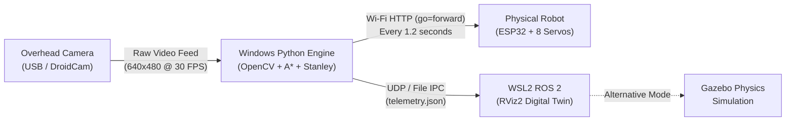
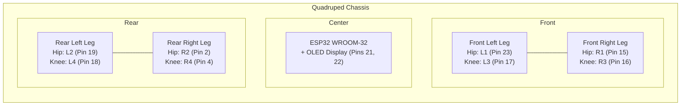
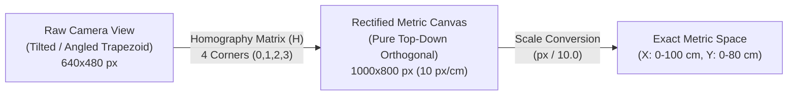
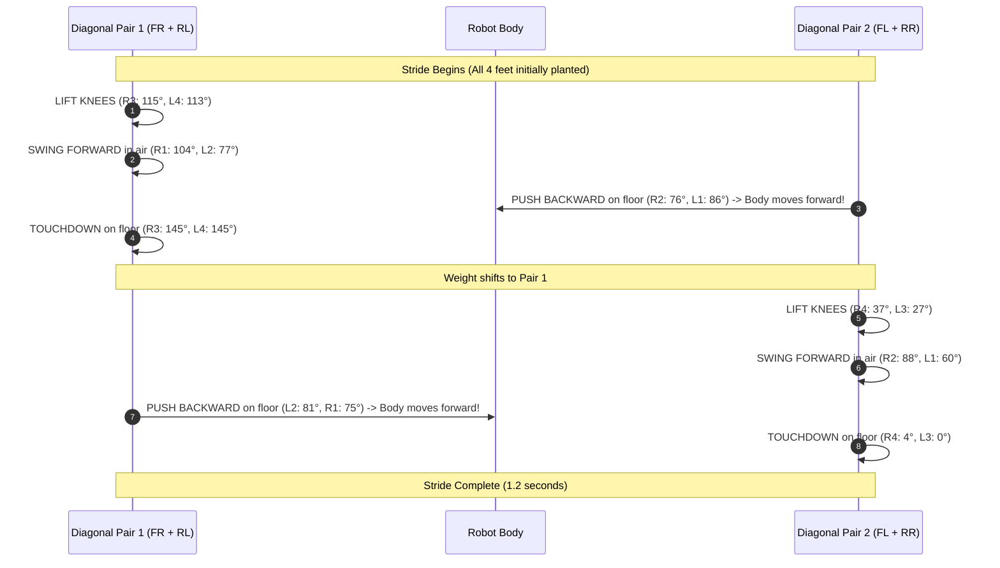
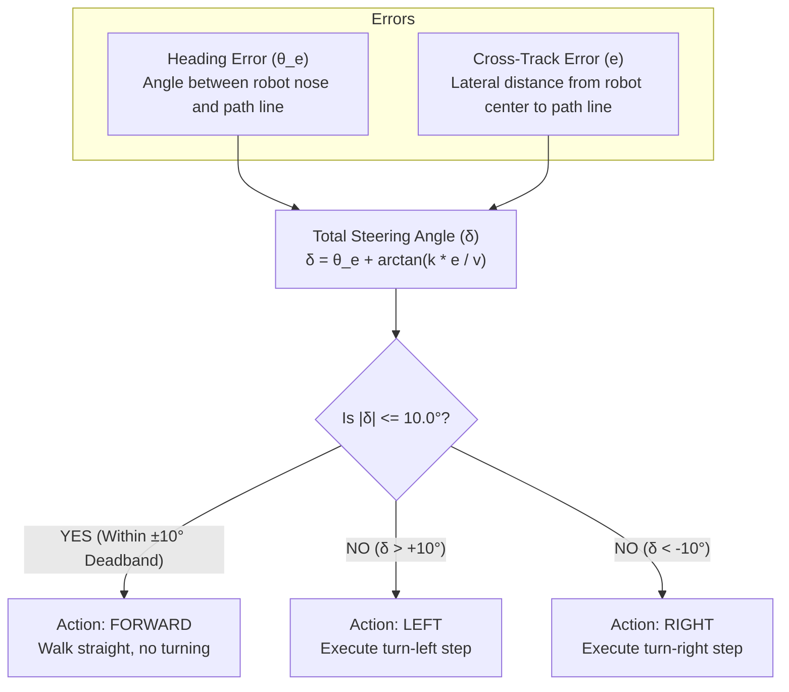
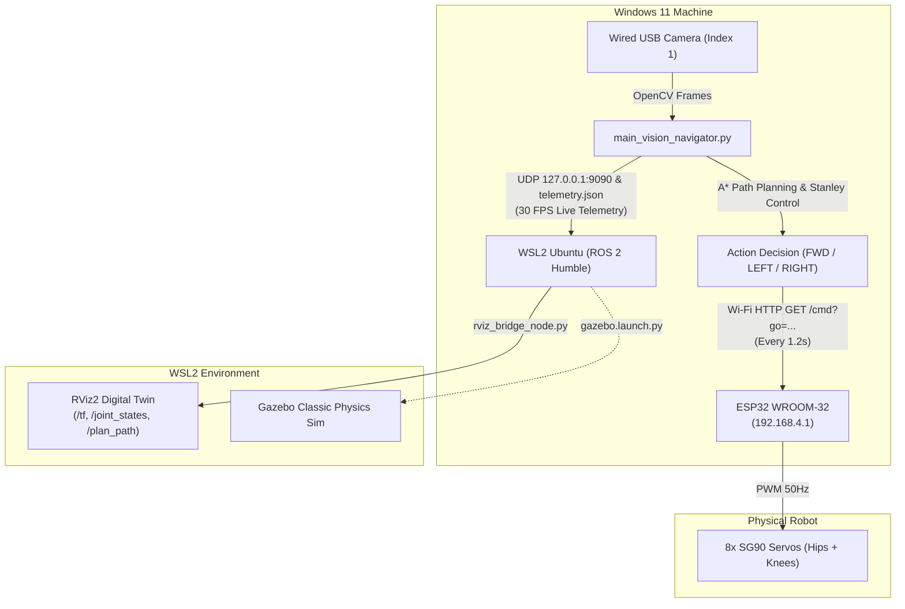

# Autonomous Overhead Vision-Guided Quadruped Navigation & Digital Twin
## Complete System Architecture & Engineering Reference Guide

---

## 1. Executive Summary & Project Overview

This project builds a fully autonomous, closed-loop robotic system where a physical 8-degree-of-freedom (8-DOF) quadruped robot named **Sesame** navigates through an obstacle arena. 

Instead of putting heavy, expensive sensors (like LiDAR or depth cameras) directly on the small robot, the system uses an **overhead bird's-eye camera** (a USB webcam or DroidCam smartphone) mounted above the arena. A host computer watches the arena, tracks the robot and obstacles using computer vision, calculates an optimal collision-free path, and transmits wireless movement commands over Wi-Fi to an ESP32 microcontroller inside the robot. Simultaneously, the real-world state is mirrored into a **ROS 2 RViz Digital Twin** and simulated in **Gazebo**.

---

## 2. Hardware Architecture & Electrical Connections

### 2.1 The Microcontroller: ESP32 WROOM-32
The brain inside the physical robot is an **ESP32 WROOM-32** (32-bit dual-core, 240 MHz, built-in 2.4 GHz Wi-Fi and Bluetooth). 
- It hosts a Wi-Fi Access Point (`Sesame-Robot` or `192.168.4.1`).
- It runs a lightweight HTTP web server and captive DNS portal.
- It generates 50 Hz PWM (Pulse Width Modulation) control signals to position all 8 servo motors.
- It drives a small $128 \times 64$ I2C OLED display on the robot's face to animate interactive expressions.

### 2.2 Motor Configuration & GPIO Pinout
The robot has **4 legs**, with **2 servo motors per leg** (1 Hip for swing rotation, 1 Knee for vertical ground clearance):

| Joint Code | Leg Location | Joint Function | ESP32 GPIO Pin | Software Channel | Motion Direction |
|:---:|:---:|:---:|:---:|:---:|:---|
| **R1** | Front Right | Hip (RFH) | **GPIO 15** | 0 | Increasing angle = swings forward |
| **R3** | Front Right | Knee (RFK) | **GPIO 16** | 5 | Increasing angle = extends down to floor |
| **L1** | Front Left | Hip (LFH) | **GPIO 23** | 2 | Decreasing angle = swings forward |
| **L3** | Front Left | Knee (LFK) | **GPIO 17** | 6 | Decreasing angle = extends down to floor |
| **R2** | Rear Right | Hip (REH) | **GPIO 2** | 1 | Increasing angle = swings forward |
| **R4** | Rear Right | Knee (REK) | **GPIO 4** | 4 | Decreasing angle = extends down to floor |
| **L2** | Rear Left | Hip (LEH) | **GPIO 19** | 3 | Decreasing angle = swings forward |
| **L4** | Rear Left | Knee (LEK) | **GPIO 18** | 7 | Increasing angle = extends down to floor |

### 2.3 OLED Display Wiring
- **SDA (Data)**: GPIO 21
- **SCL (Clock)**: GPIO 22
- **Resolution**: $128 \times 64$ monochrome pixels (SSD1306 driver, I2C address `0x3C`).

### 2.4 Power Supply Mechanism
- **Logic Power**: 3.3V power domain for the ESP32 chip and OLED.
- **Servo Power**: 5V to 6V high-current domain for the 8 SG90 servo motors.
> [!IMPORTANT]
> The servo ground and ESP32 ground are tied together (Common Ground). Servos draw up to 1.5A to 2.0A peak current during ground push-off. Powering servos through the ESP32's onboard regulator causes voltage dips (brownouts), which is why servos use an independent high-current power bus.

---

## 3. Overhead Vision & Camera Processing

### 3.1 What is ArUco?
An **ArUco marker** is a synthetic, high-contrast black-and-white square pattern (similar to a tiny QR code). Unlike complex objects, ArUco markers can be detected with near-zero latency, zero false positives, and sub-pixel accuracy.
- **Dictionary Used**: `cv2.aruco.DICT_4X4_50` (4x4 internal grid, 50 possible IDs).
- **Why 4x4?** A smaller grid means larger, bolder black/white squares, making markers readable even when the camera is high up or low resolution.

### 3.2 Marker IDs & Roles
1. **Corners 0, 1, 2, 3**: Taped to the four corners of the arena floor:
   - ID 0 = Bottom-Left $(0, 0)$
   - ID 1 = Bottom-Right $(100\text{ cm}, 0)$
   - ID 2 = Top-Right $(100\text{ cm}, 80\text{ cm})$
   - ID 3 = Top-Left $(0, 80\text{ cm})$
2. **ID 4 (or 5)**: Taped to the top of the **Robot chassis**.
3. **ID 5 (or 4)**: Taped to the **Goal destination target**.
4. **IDs 10 to 19**: Taped onto obstacle blocks (cardboard boxes, mugs, books).

### 3.3 Pixels, Centimeters & 4-Corner Planar Homography
When a camera looks at a floor from an angle, a square arena looks like an irregular trapezoid (perspective distortion). Near objects appear huge, while far objects appear small.

The system solves this with **Planar Homography**:
$$\begin{bmatrix} x_{\text{warped}} \\ y_{\text{warped}} \\ 1 \end{bmatrix} = \mathbf{H} \begin{bmatrix} x_{\text{camera}} \\ y_{\text{camera}} \\ 1 \end{bmatrix}$$

1. The camera captures raw frames at $640 \times 480$ pixels (or $1280 \times 720$).
2. The vision system finds the pixel centers of the 4 corner markers: $P_0, P_1, P_2, P_3$.
3. It defines a flat, top-down target rectangle where:
   $$\text{Scale} = 10.0\text{ pixels per cm}$$
   $$\text{Canvas Width} = 100\text{ cm} \times 10 = 1000\text{ pixels}$$
   $$\text{Canvas Height} = 80\text{ cm} \times 10 = 800\text{ pixels}$$
4. `cv2.getPerspectiveTransform()` computes the $3 \times 3$ transformation matrix $\mathbf{H}$.
5. `cv2.warpPerspective()` rectifies the tilted camera feed into a perfectly flat $1000 \times 800$ pixel top-down image. In this image, $1\text{ cm}$ on the floor is exactly $10\text{ pixels}$ everywhere.

### 3.4 Robot Heading Calculation
How does the computer know which way the robot is facing?
Every ArUco marker has 4 ordered corners: Top-Left (0), Top-Right (1), Bottom-Right (2), Bottom-Left (3).
1. Midpoint of the front edge: $M_{\text{top}} = \frac{P_0 + P_1}{2}$
2. Midpoint of the rear edge: $M_{\text{bottom}} = \frac{P_3 + P_2}{2}$
3. Forward direction vector: $\Delta x = M_{\text{top}, x} - M_{\text{bottom}, x}$, $\Delta y = M_{\text{bottom}, y} - M_{\text{top}, y}$
4. Robot heading angle:
   $$\theta = \operatorname{atan2}(\Delta y, \Delta x)$$
5. An **Exponential Moving Average (EMA)** filter ($\alpha = 0.65$) is applied:
   $$\theta_{\text{filtered}} = \theta_{\text{prev}} + \alpha \cdot (\theta_{\text{raw}} - \theta_{\text{prev}})$$
   This eliminates small visual camera jitter while reacting immediately when the robot turns.

### 3.5 Hand Detection Safety Filter
When a user puts their hand into the arena to place an obstacle, the robot should not walk into their fingers. 
The system runs an HSV color segmentation filter:
- Skin tone color range: $\text{Hue } [0, 25]$, $\text{Saturation } [52, 255]$, $\text{Value } [40, 255]$.
- The minimum saturation limit ($S \ge 52$) prevents cream or beige floor tiles from being falsely recognized as a hand.
- When hand area exceeds $3500\text{ pixels}$, a safety flag triggers, instantly commanding `stand` to pause the robot until the hand leaves.

---

## 4. Kinematics, Calibration & The Walking Gait

### 4.1 Physical Poses: Sitting vs. Standing
Servos don't know where the ground is; they only know degrees ($0^\circ$ to $180^\circ$). Through physical calibration, the robot's real joint angles were mapped:

| Joint | Sitting / Home Pose | Standing Pose (Ground Touch) | Angular Travel ($\Delta$) | Physical Meaning |
|:---:|:---:|:---:|:---:|:---|
| **R1 (Front Right Hip)** | 66° | 85° | $+19^\circ$ | Swings slightly forward |
| **R3 (Front Right Knee)** | 85° | 145° | $+60^\circ$ | Extends down to meet the floor |
| **L1 (Front Left Hip)** | 86° | 73° | $-13^\circ$ | Swings slightly forward |
| **L3 (Front Left Knee)** | 53° | 0° | $-53^\circ$ | Extends down to floor (mechanical limit) |
| **R2 (Rear Right Hip)** | 76° | 76° | $0^\circ$ | Stays at neutral lateral balance |
| **R4 (Rear Right Knee)** | 70° | 4° | $-66^\circ$ | Extends down to floor (near limit) |
| **L2 (Rear Left Hip)** | 66° | 81° | $+15^\circ$ | Angles back for rear tripod stability |
| **L4 (Rear Left Knee)** | 81° | 145° | $+64^\circ$ | Extends down to meet the floor |

### 4.2 The 6-Step Alternating Diagonal Crawl Gait
A quadruped cannot lift all legs at once. It uses **Diagonal Trot Pairs**:
- **Pair 1**: Front Right ($R1, R3$) + Rear Left ($L2, L4$)
- **Pair 2**: Front Left ($L1, L3$) + Rear Right ($R2, R4$)

### 4.3 Why 1.2 Seconds Cadence is Crucial (Fixing the "Crab Walk")
- **The Stride Time**: Each stride has 6 discrete servo position phases. With `frameDelay = 100 ms` plus the physical transit time of servo gears under load, **one complete cycle takes exactly 1.20 to 1.25 seconds**.
- **The Crab Walk Bug**: Previously, the Python script sent commands with an abort timer of only $0.65\text{ seconds}$. At $0.65\text{s}$, the robot was right in the middle of Phase 3 (Pair 1 in mid-air). The script aborted the motion, forced `stand`, and then triggered another command. Because only Pair 2 ever pushed, the robot was forced to walk sideways like a crab.
- **The Solution**: Setting the command step interval to **1.2 seconds** allows the robot to complete its entire natural 6-step cycle before the next action is evaluated.

---

## 5. Path Planning & Closed-Loop Steering Control

### 5.1 Dynamic A* Path Planning (`VisionPathPlanner`)
1. **Grid Discretization**: The arena is mapped into a discrete $1\text{ cm} \times 1\text{ cm}$ metric costmap.
2. **Obstacle Inflation**: Any detected obstacle marker has an exclusion radius of:
   $$R_{\text{exclusion}} = R_{\text{marker}} + R_{\text{robot\_half\_width}} + \text{Safety Margin} \ge 12.0\text{ cm}$$
   This guarantees the robot's physical legs never clip the edge of an obstacle.
3. **A* Search**: Finds the shortest collision-free path from the robot's $(x, y)$ to the goal $(gx, gy)$ using Euclidean distance as the heuristic $h(n) = \sqrt{(x_g - x)^2 + (y_g - y)^2}$.
4. **Line-of-Sight Shortcutter**: Raw A* paths produce jagged 45°/90° stair-steps. The shortcutter casts rays between non-adjacent waypoints. If no obstacle lies between waypoint $i$ and waypoint $i+2$, it deletes waypoint $i+1$, turning the path into smooth, direct lines.

### 5.2 Stanley Path-Following Controller (`StanleyController`)
Autonomous cars and mobile robots use the **Stanley Controller** (developed by Stanford for the DARPA Grand Challenge). It combines two types of errors:

$$\delta(t) = \theta_e(t) + \arctan\left(\frac{k \cdot e(t)}{v + \epsilon}\right)$$

1. **Heading Error ($\theta_e$)**: The angle difference between the robot's current heading $\theta_{\text{robot}}$ and the target waypoint direction $\theta_{\text{target}}$.
2. **Cross-Track Error ($e$)**: The signed perpendicular distance from the robot's center to the planned path segment.
3. **$\pm 10^\circ$ Alignment Deadband**: Quadrupeds turn in discrete angular steps (about $15^\circ$ to $20^\circ$ per turn cycle). If the controller tried to correct a tiny $3^\circ$ error, the robot would endlessly turn left and right, zig-zagging in place. A $\pm 10^\circ$ deadband guarantees that when roughly aligned, the robot charges forward smoothly.

---

## 6. Communication & Bridge Architecture

### 6.1 PC to ESP32: Wi-Fi REST Bridge
- The PC connects to the robot's Wi-Fi Access Point (`192.168.4.1`).
- Commands are sent via standard HTTP GET requests: `http://192.168.4.1/cmd?go=forward`.
- **Socket Management**: Every request includes HTTP header `'Connection': 'close'`. The ESP32 has limited RAM; closing the socket immediately prevents memory leaks and socket lockups.
- **Single-Cycle Sync**: On startup, the PC sets `/setSettings?walkCycles=1&frameDelay=100`. This instructs the ESP32 to execute exactly 1 complete stride per command, naturally returning to stand pose when finished.

### 6.2 PC to WSL2: High-Speed Digital Twin Telemetry
Windows and WSL2 (Linux) communicate via two redundant, zero-latency channels:
1. **UDP Broadcast (`127.0.0.1:9090`)**: Sends lightweight JSON telemetry packets on every camera frame (30 times per second).
2. **Atomic File IPC (`telemetry.json`)**: Writes state to shared Windows/Linux storage, guaranteeing no frame drops.

---

## 7. ROS 2 RViz Digital Twin & Gazebo Simulation

### 7.1 What is RViz2 and How Does It Work Here?
**RViz2** is a 3D visualization tool for robotics. In this project, RViz acts as a **Live Digital Twin**:
- When the overhead camera detects the real robot turning $30^\circ$ left at coordinate $(45.2\text{ cm}, 30.1\text{ cm})$, the 3D 3D robot model in RViz immediately moves to $(0.45\text{ m}, 0.30\text{ m})$ and rotates $30^\circ$.
- The bridge node (`rviz_bridge_node.py`) publishes:
  - **`/tf`**: The coordinate frame transform from the arena `map` to the robot's `base_footprint`.
  - **`/joint_states`**: 8 joint angles calculated using a Central Pattern Generator (CPG) oscillator, making the 3D model walk in sync with the real robot.
  - **`/plan_path`**: A green line showing the planned A* trajectory.
  - **`/obstacle_markers`**: 3D bounding cylinders matching the physical obstacles on the floor.

### 7.2 What is Gazebo and How Does It Work Here?
While RViz is just a visualizer (like a movie screen), **Gazebo is a full physics simulator** with gravity, mass, inertia, friction, and ground collisions:
- **`sesame_gazebo.urdf`**: Describes the robot's 3D CAD meshes, link weights (mass in kg), center-of-mass vectors, and joint effort limits.
- **`chartpaper_arena.world`**: Simulates the arena ground plane, floor friction coefficients, and lighting.
- Gazebo allows developers to test walking algorithms and path planning in simulation before testing on physical hardware.

---

## 8. Summary of Operation: Running the Whole System

| Step | Environment | Command | Description |
|:---:|:---:|:---|:---|
| **1** | ESP32 | *(Flashed via Arduino IDE)* | Robot turns on, creates Wi-Fi `192.168.4.1`, stands in ready pose. |
| **2** | Windows PowerShell | `python scripts\main_vision_navigator.py --source 1 --esp32-ip 192.168.4.1` | Captures overhead camera index 1, tracks ArUco markers, plans A* path, sends Stanley steering pulses every 1.2s. |
| **3** | WSL Ubuntu | `ros2 launch sesame_description vision_nav_rviz.launch.py` | Launches RViz2 3D Digital Twin, showing live real-time robot pose, path, and obstacles. |
| **4** | WSL Ubuntu *(Optional)* | `ros2 launch sesame_description gazebo.launch.py` | Launches full Gazebo 3D physics simulation arena. |
